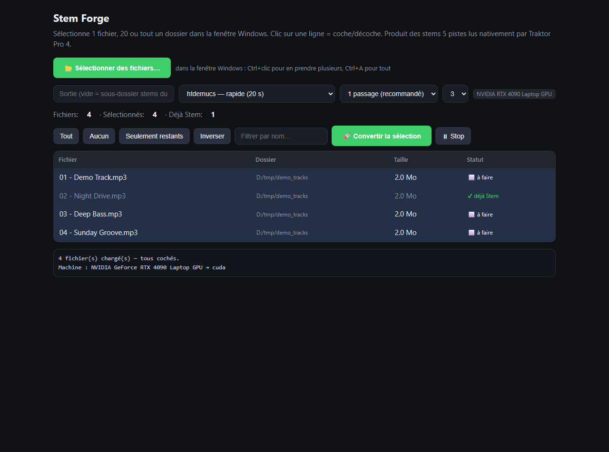

# Stem Forge



Batch-convert whole folders of music tracks into **5-stream stem files** (master + drums + bass + other + vocals) that DJ software can load — verified working with **Traktor Pro 4**.

- **Web app** (FastAPI): pick files through the native Windows file dialog (1, 20 or Ctrl+A), launch the batch, watch the live log, stop and resume later — already-converted tracks are skipped.
- **CLI**: convert a folder in one command.
- **GPU or CPU**: automatic device detection (NVIDIA CUDA when available, CPU fallback).
- Engine: [Demucs](https://github.com/facebookresearch/demucs) — Meta's `htdemucs` / `htdemucs_ft` — plus a custom MP4 writer.

> Not affiliated with, endorsed by, or connected to Native Instruments. Use it with music you own. Respect the terms of your DJ software.

---

## Français

Convertissez des dossiers entiers de morceaux en **fichiers stems 5 pistes** (mix + drums + bass + other + vocals) que votre logiciel DJ charge nativement — **vérifié avec Traktor Pro 4**.

**Installation** (Windows, Python 3.10+ — [ffmpeg](https://ffmpeg.org) requis sur le `PATH`) :

```bat
git clone https://github.com/djpolux/stemforge.git
cd stemforge
py -m venv .venv
.venv\Scripts\activate
pip install torch --index-url https://download.pytorch.org/whl/cu121
pip install demucs fastapi uvicorn numpy
```

*(pas de GPU NVIDIA ? installez `torch` tout court — la conversion tournera sur CPU, simplement plus lente)*

**Utilisation** :

```bat
python app_stem.py
```

L'interface s'ouvre sur http://127.0.0.1:9005 — bouton **📂 Sélectionner des fichiers…** (1 fichier, Ctrl+clic pour en prendre plusieurs, Ctrl+A pour tout), décochez ce que vous ne voulez pas, **🚀 Convertir**. Les modèles proposés : `htdemucs` (rapide, ~20 s/morceau) ou `htdemucs_ft` (qualité supérieure, ~40 s/morceau). Les fichiers finissent dans un sous-dossier `stems\` à côté des sources ; l'application est interrompable : relancez, les morceaux déjà convertis sont ignorés.

La ligne de commande fait la même chose sans interface :

```bat
python convert_gpu.py "D:\Musique\ma playlist"
```

Le moteur utilise Demucs de Meta — voir [Credits](#credits). Le fichier de sortie est un MP4 standard multiplexé avec 5 pistes AAC et les métadonnées stem.

> Non affilié à Native Instruments. À utiliser avec des morceaux que vous possédez, dans le respect des conditions de votre logiciel DJ.

---

## Install (Windows, Python 3.10+)

```bat
git clone https://github.com/djpolux/stemforge.git
cd stemforge
py -m venv .venv
.venv\Scripts\activate

:: GPU (NVIDIA) — recommended
pip install torch --index-url https://download.pytorch.org/whl/cu121

:: or CPU only
pip install torch

pip install demucs fastapi uvicorn numpy
```

[ffmpeg](https://ffmpeg.org/download.html) must be on `PATH` (or set the `FFMPEG_PATH` environment variable).

## Usage

Web app (opens at http://127.0.0.1:9005):

```bat
python app_stem.py
```

- **📂 Sélectionner des fichiers…** → native Windows dialog: select one file, Ctrl+click several, or Ctrl+A. Click a row to check/uncheck it.
- Bulk actions: Tout / Aucun / Seulement restants / Inverser / filter by name.
- Model choice: `htdemucs` (fast) or `htdemucs_ft` (higher separation quality, ~2x slower).
- Output: by default a `stems\` subfolder next to the source files. Interruptions are safe — relaunch and done tracks are skipped.

CLI:

```bat
python convert_gpu.py "D:\Music\my playlist" [--out D:\stems] [--model htdemucs] [--shifts 1] [--workers 3]
```

## How it works

`demucs.separate` produces the four stems; the master track is their sum; `stem_writer.py`
multiplexes the five AAC-LC 44.1 kHz streams with the manifest (stem names/colors, optional
mastering DSP chain) into a single MP4 file. Speed on an RTX 4090 laptop: ~20 s for a
4.5-minute track (`htdemucs`, 1 pass).

## Credits

- [Demucs](https://github.com/facebookresearch/demucs) (Meta, MIT) — audio separation model and `htdemucs`/`htdemucs_ft` pretrained weights.
- [ffmpeg](https://ffmpeg.org) — AAC encoding/muxing (LGPL/GPL build depending on your install).
- [FastAPI](https://fastapi.tiangolo.com), [PyTorch](https://pytorch.org).

Stem Forge (code + MP4 writer) is MIT. If you install third-party models or
plugins, they carry their own licenses — check them separately.

## License

MIT — see [LICENSE](LICENSE).